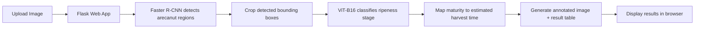
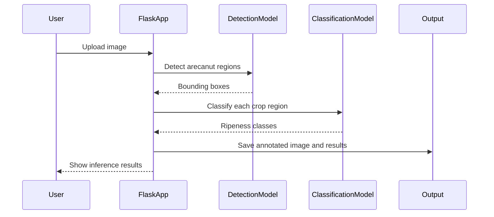

# Deep-Harvest

<div align="center">
  
    <defs>
      <linearGradient id='bg' x1='0%' y1='0%' x2='100%' y2='0%'>
        <stop offset='0%' stop-color='#0b132b'/>
        <stop offset='50%' stop-color='#1d3557'/>
        <stop offset='100%' stop-color='#0f766e'/>
      </linearGradient>
      <linearGradient id='line' x1='0%' y1='0%' x2='100%' y2='0%'>
        <stop offset='0%' stop-color='#7dd3fc'/>
        <stop offset='100%' stop-color='#86efac'/>
      </linearGradient>
    </defs>
    <rect width='1200' height='240' rx='28' fill='url(#bg)'/>
    <g opacity='0.25'>
      <circle class='orb orb-1' cx='120' cy='120' r='60' fill='#7dd3fc'/>
      <circle class='orb orb-2' cx='1010' cy='120' r='80' fill='#86efac'/>
      <circle class='orb orb-3' cx='565' cy='120' r='95' fill='#a78bfa'/>
    </g>
    <rect x='85' y='58' width='1030' height='124' rx='22' fill='rgba(15, 23, 42, 0.55)' stroke='rgba(255,255,255,0.22)'/>
    <text x='600' y='106' text-anchor='middle' font-family='Segoe UI, Arial, sans-serif' font-size='52' font-weight='700' fill='#f8fafc'>Deep-Harvest</text>
    <text x='600' y='150' text-anchor='middle' font-family='Segoe UI, Arial, sans-serif' font-size='22' fill='#dbeafe'>AI-powered arecanut detection and harvest-time estimation</text>
    <path d='M180 180 C350 120, 470 120, 610 162 S920 210, 1030 150' fill='none' stroke='url(#line)' stroke-width='6' stroke-linecap='round'>
      <animate attributeName='stroke-dasharray' values='0 1500; 600 900; 0 1500' dur='5s' repeatCount='indefinite'/>
    </path>
    <g>
      <circle cx='180' cy='180' r='8' fill='#7dd3fc'>
        <animate attributeName='r' values='8;12;8' dur='2s' repeatCount='indefinite'/>
      </circle>
      <circle cx='1030' cy='150' r='8' fill='#86efac'>
        <animate attributeName='r' values='8;12;8' dur='2s' repeatCount='indefinite'/>
      </circle>
    </g>
    <style><![CDATA[
      .orb { animation: float 4s ease-in-out infinite; }
      .orb-1 { animation-delay: 0s; }
      .orb-2 { animation-delay: 1s; }
      .orb-3 { animation-delay: 2s; }
      @keyframes float {
        0%, 100% { transform: translateY(0px); opacity: 0.25; }
        50% { transform: translateY(-12px); opacity: 0.6; }
      }
    ]]></style>
  </svg>
  " alt="Deep-Harvest banner" />
</div>

Deep-Harvest is an intelligent agricultural vision system that detects arecanut crops in images and estimates how long they need before harvest. Built with Flask, PyTorch, and torchvision, the application combines object detection and image classification to identify fruits and classify their ripening stage from a single uploaded image.

This project is designed for practical field use, where farmers or agronomists can upload an image of arecanut bunches and immediately receive:

- detected fruit locations with bounding boxes
- classified maturity stages
- estimated harvest timing for each detected item
- annotated visual results saved in the app's output folders

## Why this project matters

Arecanut cultivation depends heavily on crop maturity. Manual assessment is time-consuming, subjective, and often inconsistent across large farms. Deep-Harvest aims to make ripeness checking more consistent, faster, and more scalable by using computer vision rather than reliance on visual estimation alone.

The app tries to bridge the gap between agriculture and AI by transforming a field image into structured, actionable information such as:

- which arecanuts are present
- which ones are immature or nearing harvest
- how long each cluster may take to become ready for harvesting

---

## Key features

- Object detection using Faster R-CNN with a ResNet-50 FPN v2 backbone
- Ripeness classification using Vision Transformer (ViT-B16)
- Non-maximum suppression to remove duplicate boxes and refine results
- Cropping and resizing detected regions before classification
- Bounding box visualization on processed images
- Flask-based web interface for uploading and analyzing images
- Output results saved to dedicated folders for review and reuse

---

## System overview



---

## How the model pipeline works

The project uses a two-stage deep learning pipeline:

1. Detection stage
   - A Faster R-CNN model identifies probable arecanut instances in the input image.
   - Bounding boxes are created around each detected region.
   - Duplicate or overlapping detections are filtered using non-maximum suppression (NMS).

2. Classification stage
   - Each detected crop region is cropped and resized.
   - A ViT-B16 classifier predicts the ripening class.
   - The predicted class is mapped to a textual estimate such as:
     - "It is inflorescence; requires long time."
     - "May require around 2.5 months to ripen"
     - "Ready to harvest!!"

This design allows the app to combine spatial localization with maturity recognition, which is suitable for agricultural image analysis.

---

## Technical stack

- Python 3.x
- Flask
- PyTorch
- TorchVision
- PIL (Pillow)
- NumPy
- Matplotlib
- Werkzeug

---

## Project layout

```text
Deep-Harvest/
├── app.py                    # Flask app, model loading, inference logic
├── image_render.html        # UI for image upload and result visualization
├── README.md                # Project documentation
├── LICENSE                  # Project license
├── templates/               # Flask templates folder (required by the app)
│   └── image_render.html   # UI template
├── static/
│   ├── uploads/             # uploaded images
│   ├── plots/               # detection visualizations
│   └── results/              # annotated classification outputs
└── .venv/                   # optional local virtual environment
```

Note: The current application code expects the HTML file under a `templates/` directory and the static image folders to exist before running the app.

---

## Prerequisites

Before running the project, make sure you have:

- Python 3.9 or newer
- pip installed
- a working CUDA-capable GPU is optional but recommended
- trained model weights for both:
  - detection model
  - classification model

The project currently loads model weights with hard-coded Windows paths such as:

```python
det_model.load_state_dict(torch.load("E:\Downloads\Faster_rcnn_model(5).pth", map_location=torch.device("cpu")))
cls_model.load_state_dict(torch.load("D:\classification_vitb16_model(1).pth", map_location=torch.device("cpu")))
```

These paths must be updated to match your local environment or to a project-managed models folder.

---

## Setup and installation

### 1) Create a virtual environment

```bash
python -m venv .venv
source .venv/bin/activate
# On Windows: .venv\Scripts\activate
```

### 2) Install dependencies

```bash
pip install --upgrade pip
pip install flask torch torchvision pillow numpy matplotlib
```

### 3) Prepare folders

```bash
mkdir -p templates static/uploads static/plots static/results
```

### 4) Move the HTML template

```bash
cp image_render.html templates/
```

### 5) Update model paths

Open `app.py` and replace the hard-coded weight paths with the correct locations on your machine, for example:

```python
det_model.load_state_dict(torch.load("./models/faster_rcnn_arecanut.pth", map_location=torch.device("cpu")))
cls_model.load_state_dict(torch.load("./models/vit_b16_ripeness.pth", map_location=torch.device("cpu")))
```

---

## Running the app

```bash
python app.py
```

Then open the app in your browser at:

```text
http://localhost:8001
```

---

## How to use the app

1. Open the web UI in your browser.
2. Upload an arecanut image.
3. Click the `Process Image` button to run detection.
4. Click `Estimate Image` to classify ripening status and generate the output.
5. Review:
   - the annotated detection image
   - the estimated maturity labels
   - the harvest-time prediction table

---

## Example workflow



---

## Output interpretation

The application generates two kinds of output:

### 1) Annotated detection image

This image shows the original uploaded photograph with bounding boxes around each detected arecanut region.

### 2) Estimated harvest results

The result dictionary contains IDs and maturity labels, such as:

```python
{
  "id": [1, 2, 3],
  "time_required": [
      "May require around 1 month to ripen",
      "Ready to harvest!!",
      "May require around 2.5 months to ripen"
  ]
}
```

These labels are used to guide harvest planning and field decisions.

---

## Current implementation notes

This project is a functional prototype rather than a production deployment system. Some aspects still reflect an experimental setup, including:

- direct local file loading for trained model weights
- hardcoded paths for model checkpoints
- a simple single-image web workflow
- no user authentication or database layer

These are reasonable for a research or lab prototype, but they can be improved for production deployment.

---

## Future improvements

Potential enhancements include:

- deployment as a production-ready web service
- support for batch image processing
- cloud model storage and versioning
- automatic dataset collection from farm images
- confidence scoring and threshold tuning
- multi-crop or multi-variety support
- REST API integration for mobile or dashboard clients
- integration with farm management software

---

## License

This project is licensed under the MIT License. See the [LICENSE](LICENSE) file for details.

---

## Contact

For model files, collaboration, or project inquiries, reach out via the contact provided in the original project notes or update this section with your preferred communication channel.

---

## Summary

Deep-Harvest demonstrates how modern computer vision can be used to support precision agriculture. By combining targeted object detection with crop maturity classification, the system provides an automated, visual, and interpretable approach to crop monitoring and harvest estimation.

It is a strong example of how artificial intelligence can be applied to real agricultural workflows, helping reduce subjective decisions and improve harvest planning.
